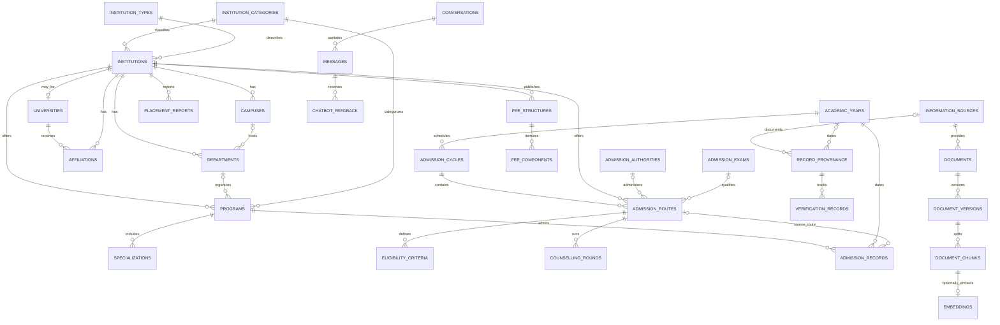

# Universal CollegeHub database architecture

## Scope and compatibility

CollegeHub now has a SQLAlchemy 2.x data layer with Alembic migrations. It supports SQLite for local development and PostgreSQL through psycopg 3 for deployment. `DATABASE_URL` selects the database; without it, the data layer uses the separate `instance/collegehub.sqlite3` file.

The original Flask pages continue to use the bundled `sample_colleges.db` demo database and its existing SQLite queries. The universal schema is separate: no legacy records are copied, rewritten, or marked verified. Alembic refuses to initialize the universal schema on a legacy SQLite database containing conflicting tables.

## Supported institution and admission data

- Institution categories: Engineering, Medical, Agriculture, Arts, and Science.
- Institution types: Government, Government-aided, Private, Deemed university, Central university, and State university.
- Institutions can have campuses, departments, programs, specializations, accreditation, and university affiliations.
- Admissions are represented by authorities, exams, cycles, routes, eligibility criteria, counselling rounds, seat matrices, and sourced admission records. An admission record identifies its measurement type and unit; rank, score, marks, percentage, cutoff score, and merit position are not conflated.
- Fees are represented as academic-year fee structures and separately sourced components. Placement reports store reported counts and salary figures; a missing input is not synthesized into a percentage.
- Factual records reference provenance. Source and verification history remain separate from imported job metadata.
- RAG preparation is isolated in documents, versions, chunks, embeddings, conversations, messages, and feedback. Embeddings are empty until a later, implemented ingestion pipeline exists.

## Data access

Repository and service classes in `repositories.py` and `services.py` prepare queries for institution search/profile/comparison, program search, admission and fee records, recommendation candidates, and verification history. Read-only JSON routes are available:

- `GET /api/institutions?q=&district=&category=&type=&limit=&offset=`
- `GET /api/institutions/{id}`
- `GET /api/programs?q=&institution_id=&category=&limit=&offset=`
- `GET /api/institutions/{id}/admissions`
- `GET /api/institutions/{id}/fees`
- `GET /api/institutions/compare?ids=1,2`
- `GET /api/institutions/recommendations?district=&category=&program=&limit=`
- `GET /api/provenance/{id}/verification-history`

The database-backed public routes use the universal schema and return 503 when it has not been migrated or cannot be reached; they do not fall back to the bundled demo database. A limited optional single-admin console supports source registration, the fixed Anna University importer, and provenance status reviews when configured with an administrator password hash and session secret. It is not a multi-user identity/role system. Student accounts, chatbot responses, and RAG retrieval are not implemented.

## Database relationship diagram

See [DATABASE_SCHEMA.md](./DATABASE_SCHEMA.md) for the table inventory and key constraints.
